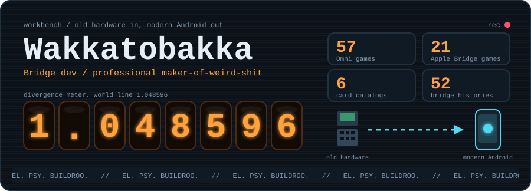
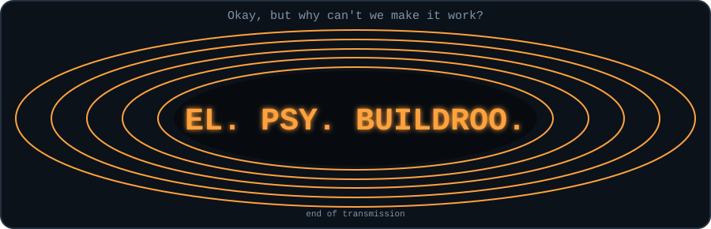

# Hey, I'm Wakka 👋

### Bridge dev / professional maker-of-weird-shit

I like taking software that was considered dead or obsolete and figuring out how to get it running anyway. Mostly old phone games on modern Android.

I work with AI through directing, testing, and iterating. This all gets squeezed around my job and family. I just think old things are neat 😅

**[Visit the workshop](https://wakkatobakka.github.io/) · [Play with Omni](https://github.com/Wakkatobakka/Omni-Player/releases) · [Play with Apple Bridge](https://github.com/Wakkatobakka/Apple-Bridge/releases) · [See how it broke](https://wakkatobakka.github.io/bridges-before-you-played-them/)**

 

I got tired of juggling separate bridges. Omni brings supported old mobile games together in one Android app. Supply the original game files, tap **Load Game**, and launch them from your library.

The public games span **BREW, DoJa, J2ME, ExEn, Zeebo, and N-Gage (classic and 2.0)**: BioShock 3D, Metal Gear Solid Mobile, Dirge of Cerberus: Lost Episode, and a growing pile of others.

**[Download Omni](https://github.com/Wakkatobakka/Omni-Player/releases) · [Games, files & sources](https://github.com/Wakkatobakka/Omni-Player/blob/main/GAME_GUIDE.md) · [Setup & project details](https://github.com/Wakkatobakka/Omni-Player)**

**Android 11+ / ARM64.** Public builds are betas; the game guide and release notes carry the current lineup and known issues.

 

The early iPhone rabbit hole got its own player. Apple Bridge brings **21 games together on Android in v0.0.8**, including GTA Vice City, Mass Effect Infiltrator, Infinity Blade II, Spider-Man: Total Mayhem, Dead Space, and Mass Effect Galaxy.

The games keep their original interfaces, touchscreen controls, and tilt inputs where they use them. Supply a matching original `.ipa`, import it, and play from your library. The compatibility bridges are included.

**[Download Apple Bridge](https://github.com/Wakkatobakka/Apple-Bridge/releases) · [Games, original files & playing notes](https://github.com/Wakkatobakka/Apple-Bridge/blob/main/GAME_GUIDE.md) · [Setup & project details](https://github.com/Wakkatobakka/Apple-Bridge)**

**Android 11+ / ARM64.** Each game is personally playtested through its tutorial and into the first level, often further. Full start-to-finish completion has not been verified for every title.

 

Getting a game to run produces some very strange intermediate results.

I went back through the work and put together **52 histories from my private bridge work**, with screenshots, development receipts, and the fixes that carried from one game into another. This is the story behind the pile; the public playable lineup lives with Omni.

**[Read the histories](https://wakkatobakka.github.io/bridges-before-you-played-them/) · [Archive repository](https://github.com/Wakkatobakka/bridges-before-you-played-them)**

 

These grew out of the places I used and the things I found while hunting for games. Six searchable catalogues, with source links and credits so the next person has a trail to follow.

<b>Open the card catalogs</b>

 

| Catalogue | Down this rabbit hole |
| --- | --- |
| [Qualcomm BREW](https://wakkatobakka.github.io/qualcomm-brew-archive/) | Games, demos, utilities, alternate builds, and the packages that survived. |
| [DoJa](https://wakkatobakka.github.io/doja-archive/) | i-mode titles, trials, translations, and a lot more than the handful I went looking for. |
| [ExEn](https://wakkatobakka.github.io/exen-game-archive/) | Source-linked listings from a largely forgotten corner of mobile gaming. |
| [Zeebo](https://wakkatobakka.github.io/zeebo-archive/) | Games, package variants, developer tools, and the printed guide's paper trail. |
| [J2ME](https://wakkatobakka.github.io/j2me-archive/) | Handsets, editions, languages, and the enormous world hiding behind the .jar. |
| [N-Gage](https://wakkatobakka.github.io/ngage-archive/) | Classic N-Gage and N-Gage 2.0: games, alternate editions, development builds, and the material packed in beside them. |

The catalogues reach well beyond Omni's supported games. Original files stay with their source collections; each catalogue keeps its sources and evidence notes close by.

Apparently, "I wonder what happened to that game" is how you become a librarian.

 

Four standalone Android apps from the work that led into Omni. All four are also in the player; their own projects still have downloads and setup instructions.

<b>Open the bridge bay</b>

 

| Project | Game / platform |
| --- | --- |
| [Dirge Bridge](https://github.com/Wakkatobakka/Dirge-Bridge) | Final Fantasy VII: Dirge of Cerberus – Lost Episode · DoJa |
| [DeadShot Bridge](https://github.com/Wakkatobakka/DeadShot-Bridge) | Devil May Cry: DeadShot · DoJa |
| [FFVII Snowboarding Bridge](https://github.com/Wakkatobakka/FFVII-Snowboarding-Bridge) | Final Fantasy VII Snowboarding · DoJa |
| [Rush Marine Bridge](https://github.com/Wakkatobakka/Rush-Marine-Bridge) | Mega Man: Rush Marine · BREW |

 

| Project | What it does |
| --- | --- |
| [Workbench Continuity](https://github.com/Wakkatobakka/workbench-continuity) | Keeps project files, build tools, decisions, and the next action together between AI chats. |
| [Android Build Capsule](https://github.com/Wakkatobakka/android-build-capsule) | Prepares Android build tools for AI chats with code execution. Give chat hands. |
| [Artifact Passport](https://github.com/Wakkatobakka/artifact-passport) | Carries a project's purpose, decisions, and working state into the next conversation. |
| [Retro Mod Pod](https://github.com/Wakkatobakka/Retro-Mod-Pod) | Applies supported retro-game patches locally in a browser. Game in, patch in, KABOOMY. |

 

This started with me asking AI for Mass Effect-style codex entries to listen to while mowing. It became a fictional universe of incident reports, correspondence, cosmic horror, weird humor, and occasional kindness. Then I had to go recover it from my own scattered chats and files. Another rabbit hole 😅

**[Read the five public records](https://wakkatobakka.github.io/ripple/) · [Project & origins](https://github.com/Wakkatobakka/ripple)**

 

**Planned: Build your own bridge.** Guidance and tools for investigating a game and adding a tested bridge to your own private Omni. I want people to pursue their own games without waiting on me. This workflow isn't available yet.

 

<b>🤘</b>

